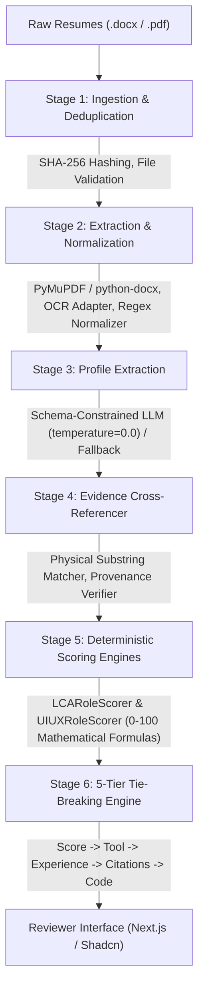

# Rankres ATS — AI Resume Screener & Evaluation Platform

> **Growth For Impact (GFI) — Software Engineer Assignment**  
> Production-grade, deterministic AI candidate screening, explainable multi-role ranking, and audit-proven HR reviewer portal.

---

## 1. Executive Summary & Problem Definition

The **Rankres ATS** automates the evaluation of candidates against two distinct baseline job profiles specified in the canonical assignment requisitions:

1. **Requisition 01: Sustainability & Life Cycle Assessment (LCA) Specialist**
   - **Baseline:** 2–3 years of independent LCA experience (per canonical `JD1 (LCA).txt` Lines 29–30).
   - **Core Requirements:** Hands-on modeling in GaBi or SimaPro, ISO 14040/14044 standard conformance, Environmental Product Declarations (EPDs), and onsite availability in Chennai.
   - **Passing Benchmark Threshold:** $\ge 55\%$.

2. **Requisition 02: Product & UI/UX Design Specialist**
   - **Baseline:** Early-stage target of 0–1 years experience / internship (per `JD2.txt` Line 19).
   - **Core Requirements:** High-fidelity prototyping in Figma, user research & usability testing, behavioral design & cognitive psychology, and verified portfolio deliverable proof.
   - **Passing Benchmark Threshold:** $\ge 50\%$.

### Architectural Core Philosophy
- **Generative AI is strictly restricted to extraction:** LLMs extract structured candidate entities and cite verbatim resume quotes.
- **Python is the sole scoring authority:** All final scores, qualification decisions, and rankings are calculated using versioned, deterministic mathematical formulas in Python.
- **Zero-Hallucination Evidence Provenance:** Every point awarded is cross-referenced against the raw document text. Claims not backed by physical text are quarantined into `unsupported_claims` and penalize the extraction confidence score.

---

## 2. End-to-End Pipeline Architecture

The platform operates across 6 discrete, transactional pipeline stages:



### Stage 1: Ingestion & Content-Addressed Deduplication (`IngestionService`)
- Computes SHA-256 hash of resume bytes.
- Rejects exact duplicate submissions before disk or database writes (`DuplicateResumeError`).
- Generates human-readable, deterministic candidate codes (`CAND-001` through `CAND-048`).
- Enforces strict MIME-type validation (`application/pdf`, `application/vnd.openxmlformats-officedocument.wordprocessingml.document`) and 10MB file size ceiling.

### Stage 2: Format Parsing & Conservative Normalization (`ExtractionPipelineService`)
- Routes `.docx` files to `python-docx` XML parser and `.pdf` files to `PyMuPDF` (`fitz`).
- Applies conservative Unicode normalization: strips zero-width spaces (`\u200b`), collapses multi-space runs, and normalizes smart quotes while strictly preserving punctuation and paragraph boundaries needed for citation verification.
- **Corrupted/Empty File Protection:** Documents with 0 extracted text characters (e.g. `CAND-005`) are immediately marked with `status = FAILED`, `is_empty = True`, and routed to `MANUAL_REVIEW_REQUIRED` (never assigned an artificial 0 score).

### Stage 3: Schema-Constrained Profile Extraction (`ProfileExtractionService`)
- Formulates a zero-temperature extraction prompt instructing the AI model to output strictly valid JSON conforming to the Pydantic `CandidateProfile` schema.
- **Provider Redundancy:** 
  - Primary: Google Gemini (`gemini-2.0-flash`) via structured JSON schema enforcement (`responseMimeType: application/json`).
  - Fallback: Local deterministic regex-based extractor (`mock_provider.py`) ensuring 100% offline functionality without external API tokens.

### Stage 4: Zero-Hallucination Evidence Cross-Referencer (`EvidenceVerifier`)
- Searches the physical resume text for every extracted claim (skill, tool, degree, responsibility snippet).
- Flags unverified claims with `is_verified = False` and moves them to `unsupported_claims`.
- Computes mathematical `extraction_confidence`:
  $$\text{Confidence} = \frac{\text{Verified Claims Count}}{\text{Total Extracted Claims Count}}$$
- Verified snippets are stored in SQLite/Supabase with physical character offsets for UI citation.

### Stage 5: Deterministic Multi-Role Scoring Engines (`LCARoleScorer`, `UIUXRoleScorer`)
- Evaluates candidate profiles independently against both Requisition 01 (LCA) and Requisition 02 (UI/UX).
- Computes criterion scores using weighted mathematical formulas (see Section 3).

### Stage 6: Deterministic 5-Tier Tie-Breaking Algorithm
- In the event that two or more candidates achieve identical match scores, ties are resolved deterministically without human bias or random sorting:
  1. **Tier 1:** Final Weighted Score (0–100).
  2. **Tier 2:** Domain Core Tool Proficiency (GaBi/SimaPro score for LCA; Figma score for UI/UX).
  3. **Tier 3:** Verified Months of Experience in Role Domain.
  4. **Tier 4:** Total Verified Physical Evidence Citation Count.
  5. **Tier 5:** Candidate Code ascending (`CAND-001` < `CAND-002`).

---

## 3. Mathematical Scoring Formulations

### Requisition 01: Sustainability & LCA Specialist
- **Benchmark Qualification Threshold:** $\ge 55.0\%$
- **Formula:** 
  $$S_{\text{LCA}} = w_1 s_1 + w_2 s_2 + w_3 s_3 + w_4 s_4 + w_5 s_5$$

| Criterion ($i$) | Description & Source JD Reference | Weight ($w_i$) | Scoring Logic ($s_i$) |
| :--- | :--- | :---: | :--- |
| **1. LCA Experience** | Independent LCA/sustainability consulting experience (`JD1` Lines 29–30: 2–3 yrs baseline). | **25%** | $\ge 48$ mos: **100%** (25 pts)<br>$\ge 24$ mos: **80%** (20 pts)<br>$\ge 12$ mos: **48%** (12 pts)<br>$> 0$ mos: **24%** (6 pts)<br>$0$ mos: **0%** (0 pts) |
| **2. Modeling Tools** | Hands-on proficiency in GaBi or SimaPro software (`JD1` Lines 31–32). | **25%** | GaBi **and** SimaPro: **100%** (25 pts)<br>GaBi **or** SimaPro: **80%** (20 pts)<br>Alternative (openLCA, Umberto): **40%** (10 pts)<br>None: **0%** (0 pts) |
| **3. Standards & EPDs** | Compliance with ISO 14040/14044 standards and EPD generation (`JD1` Lines 33–34). | **20%** | ISO 14040/14044 **and** EPDs: **100%** (20 pts)<br>ISO 14040/14044: **75%** (15 pts)<br>General GHG / Carbon Accounting: **50%** (10 pts)<br>None: **0%** (0 pts) |
| **4. Education** | Degree in Environmental Science, Chemical Engineering, or Sustainability. | **15%** | Master's/PhD in Environmental/LCA field: **100%** (15 pts)<br>Bachelor's in relevant STEM discipline: **73%** (11 pts)<br>Unrelated Degree: **33%** (5 pts) |
| **5. Location / Onsite** | Willingness to work onsite in Chennai (`JD1` Line 7). | **15%** | Already in Chennai / explicitly willing: **100%** (15 pts)<br>Relocation `UNKNOWN`: **67%** (10 pts — neutral credit)<br>Explicitly declined onsite: **0%** (0 pts) |

---

### Requisition 02: Product & UI/UX Design Specialist
- **Benchmark Qualification Threshold:** $\ge 50.0\%$
- **Formula:** 
  $$S_{\text{UI/UX}} = w_1 s_1 + w_2 s_2 + w_3 s_3 + w_4 s_4 + w_5 s_5$$

| Criterion ($j$) | Description & Source JD Reference | Weight ($w_j$) | Scoring Logic ($s_j$) |
| :--- | :--- | :---: | :--- |
| **1. Figma Prototyping** | High-fidelity interactive prototyping in Figma (`JD2` Lines 11, 23). | **25%** | Figma + Secondary (Framer, ProtoPie, XD): **100%** (25 pts)<br>Figma proficiency verified: **80%** (20 pts)<br>Secondary prototyping tools only: **40%** (10 pts)<br>None: **0%** (0 pts) |
| **2. User Research** | Usability testing, interviews, and journey mapping (`JD2` Line 10). | **25%** | Testing **and** Research methodologies: **100%** (25 pts)<br>Usability testing **or** User interviews: **72%** (18 pts)<br>Wireframing / information architecture only: **40%** (10 pts)<br>None: **0%** (0 pts) |
| **3. Behavioral Design** | Cognitive psychology, behavioral design, or design systems (`JD2` Line 13). | **20%** | Cognitive psychology / behavioral design: **100%** (20 pts)<br>Design system components & tokens: **60%** (12 pts)<br>General visual design heuristics: **30%** (6 pts)<br>None: **0%** (0 pts) |
| **4. Experience Level** | Early-stage target: 0–1 years intern experience (`JD2` Line 19). | **15%** | 6–18 months design experience / internship: **100%** (15 pts)<br>$< 6$ months entry experience: **80%** (12 pts)<br>Overqualified ($> 3$ years senior exp): **53%** (8 pts — intern target discount) |
| **5. Portfolio Proof** | Live portfolio links (Behance, Dribbble, Figma, personal website). | **15%** | Live portfolio link cited & verified: **100%** (15 pts)<br>Portfolio mentioned without active link: **53%** (8 pts)<br>No portfolio evidence: **0%** (0 pts) |

---

## 4. Reviewer UI & Features

Built with **Next.js 14 (App Router)**, **TypeScript**, **Tailwind CSS**, and **Official Shadcn UI**:

- **Enterprise Dual-Theme System:** Zinc dark and light palettes toggled via header control, honoring OS `color-scheme` contrast.
- **Candidate Pipeline Table:** Quick filtering by status (`All`, `Qualified`, `LCA`, `UI/UX`, `Needs Review`), search by name/code/skills, progress bars, and sortable headers.
- **4-Tab Candidate Dossier Drawer (`CandidateDrawer.tsx`):**
  1. *Requisition Scoring & Evidence:* Interactive selector between LCA and UI/UX with criterion points, scoring notes, and verbatim quoted evidence citations.
  2. *Structured Profile:* Verified total experience, tools tags, employment history with bullet points, and education credentials.
  3. *Source Resume Text:* Dual view toggling between Normalized clean text and Raw extracted physical text.
  4. *Audit & Confidence:* Extraction confidence gauge and parser warnings list.
- **Direct Resume Access:** Header **Resume** button streams the physical `.pdf` or `.docx` file via `GET /api/candidates/{id}/resume`.
- **Dynamic Requisition Manager (Post a Job):** Modal allowing recruiters to publish new custom open requisitions with departments, locations, required skills, and benchmark thresholds.
- **Live Testing Dropzone (Screen Resume):** Drag-and-drop modal to upload new resumes for instant scoring and pipeline insertion.

---

## 5. Quick Start & Execution Guide

### Option A: Local Bare-Metal Setup

#### 1. Clone & Configure Environment
```bash
git clone https://github.com/Aryanwadhwa14/AI-screener.git
cd AI-screener
cp .env.example .env
```

#### 2. Start Backend (FastAPI)
```powershell
# From repository root:
$env:PYTHONPATH='backend'
python -m uvicorn app.main:app --host 0.0.0.0 --port 8000 --reload
```
- Health Check: [http://localhost:8000/api/health](http://localhost:8000/api/health)
- Interactive OpenAPI Docs: [http://localhost:8000/docs](http://localhost:8000/docs)

#### 3. Start Frontend (Next.js)
```powershell
# In a new terminal:
cd frontend
npm install
npm run dev
```
- Open [http://localhost:3000](http://localhost:3000)

---

### Option B: Docker Compose (Production Multi-Container)

One command builds and runs both services with persistent storage and healthchecks:

```bash
docker compose up --build -d
```

- **Frontend:** [http://localhost:3000](http://localhost:3000)
- **Backend API:** [http://localhost:8000/api/health](http://localhost:8000/api/health)
- **Stop Containers:** `docker compose down`

---

## 6. Reproducible Verification & Seeding Script

To prove that the assignment is evaluated deterministically by code and not populated with canned data, run the automated pipeline CLI:

```powershell
# Run full evaluation across all 47 resumes:
$env:PYTHONPATH='backend'
python backend/seed.py

# Or wipe SQLite database and re-evaluate completely from scratch:
$env:PYTHONPATH='backend'
python backend/seed.py --reset
```

### Expected Output Report
```text
======================================================================
  Rankres ATS — Deterministic Pipeline Seeding & Scoring Engine
======================================================================
[STEP 1/4] Discovered 47 resumes in 'data'
[STEP 2/4] Ingesting and deduplicating resumes...
  -> Ingestion Complete: 47 newly ingested, 0 duplicates skipped.
[STEP 3/4] Extracting text & structured profiles with evidence cross-referencing...
  [01/47] Profile parsed & verified for CAND-001
  ...
[STEP 4/4] Evaluating candidates against JD1 (LCA) and JD2 (UI/UX)...
======================================================================
  EVALUATION SUMMARY REPORT
======================================================================
  Total Candidates Evaluated  : 47
  LCA Specialist Qualified    : 2 (Benchmark >= 55%)
  UI/UX Designer Qualified    : 24 (Benchmark >= 50%)
  Dual Match (Both Qualified) : 0
  Under Benchmark / Review    : 21
======================================================================
Top 3 LCA Candidates:
  Rank #01: CAND-047 — Score: 63.0% (QUALIFIED)
  Rank #02: CAND-028 — Score: 58.0% (QUALIFIED)
  Rank #03: CAND-045 — Score: 50.0% (UNQUALIFIED)

Top 3 UI/UX Candidates:
  Rank #01: CAND-014 — Score: 80.0% (QUALIFIED)
  Rank #02: CAND-017 — Score: 80.0% (QUALIFIED)
  Rank #03: CAND-027 — Score: 80.0% (QUALIFIED)
======================================================================
```

---

## 7. Environment Variables Reference

| Variable | Default Value | Description |
| :--- | :--- | :--- |
| `ENVIRONMENT` | `production` | Runtime mode (`development` or `production`). |
| `LOG_LEVEL` | `INFO` | Python logging severity. |
| `BACKEND_HOST` | `0.0.0.0` | Binding host interface. |
| `BACKEND_PORT` | `8000` | Port for FastAPI server. |
| `CORS_ORIGINS` | `http://localhost:3000` | Permitted origins for CORS middleware. |
| `SQLITE_DB_PATH` | `data/app.db` | Local SQLite database file path. |
| `LOCAL_STORAGE_DIR` | `data/storage/resumes` | Local directory for private resume file storage. |
| `NEXT_PUBLIC_API_URL` | `http://localhost:8000` | API base URL for frontend requests & Next.js rewrites. |
| `LLM_PROVIDER` | `gemini` | Extraction provider (`gemini`, `openai`, or `mock`). |
| `GEMINI_API_KEY` | *(Optional)* | Google Generative Language API key. If omitted, uses deterministic mock extractor. |
| `SUPABASE_URL` | *(Optional)* | Cloud Supabase PostgreSQL URL. |
| `SUPABASE_SERVICE_ROLE_KEY` | *(Optional)* | Cloud Supabase Service Role Key for storage buckets. |

---

## 8. REST API Reference

| Method | Endpoint | Description |
| :--- | :--- | :--- |
| `GET` | `/api/health` | Returns system health, database connection state, and storage mode. |
| `GET` | `/api/candidates` | Paginated candidate list with filter parameters (`page`, `page_size`, `classification`). |
| `GET` | `/api/candidates/{id}` | Complete candidate dossier, structured profile, and multi-role breakdowns. |
| `GET` | `/api/candidates/{id}/resume` | Streams original `.docx` or `.pdf` file with inline disposition. |
| `POST` | `/api/candidates/{id}/retry` | Re-runs text extraction and scoring pipeline for a specific candidate. |
| `GET` | `/api/rankings/{role_key}` | Deterministic candidate rankings for `LCA` or `UI_UX` with tie-breaker details. |
| `POST` | `/api/resumes/upload` | Ingests, deduplicates, and immediately scores an uploaded resume document. |
| `POST` | `/api/evaluations/batch` | Re-evaluates all candidates currently in the database. |
| `GET` | `/api/methodology` | Programmatic access to scoring criteria, weights, thresholds, and governance rules. |

---

## 9. Automated Test Suite

Run the full pytest suite from the repository root:

```powershell
$env:PYTHONPATH='backend'
pytest backend/tests -v
```

The 45 automated tests verify:
- Ingestion deduplication and rejection of corrupted/unsupported file types.
- PyMuPDF and python-docx text extraction integrity.
- Zero-hallucination evidence verifier regex matching.
- Exact mathematical score computation against manual baseline fixtures.
- 5-Tier deterministic tie-breaking invariant enforcement.
- Graceful error handling for empty documents (`CAND-005`).

---

## 10. Repository File Structure

```text
AI-screener/
├── backend/
│   ├── app/
│   │   ├── api/                  # Endpoints (candidates, evaluations, resumes)
│   │   ├── core/                 # Config, exceptions, logging
│   │   ├── models/               # Relational entities (Candidate, Document, Evaluation)
│   │   ├── schemas/              # Pydantic v2 validation models
│   │   ├── services/
│   │   │   ├── database/         # SQLiteRepository & SupabaseRepository
│   │   │   ├── evidence/         # EvidenceVerifier (zero-hallucination cross-referencer)
│   │   │   ├── extraction/       # PyMuPDF, python-docx, OCR adapter, ProfileService
│   │   │   ├── ingestion/        # IngestionService, SHA-256 deduplicator, validator
│   │   │   ├── llm/              # GeminiProvider & MockProvider
│   │   │   ├── scoring/          # LCARoleScorer, UIUXRoleScorer, Evaluator
│   │   │   └── storage/          # LocalStorageService & SupabaseStorageService
│   │   └── main.py               # FastAPI application entrypoint
│   ├── migrations/               # PostgreSQL schema migrations (001 to 004)
│   ├── tests/                    # 45 automated unit & integration test suites
│   ├── Dockerfile                # Production Python 3.12 slim container
│   ├── requirements.txt          # Python dependencies
│   └── seed.py                   # Reproducible seeding & scoring CLI
│
├── frontend/
│   ├── app/
│   │   ├── methodology/          # Interactive scoring methodology page
│   │   ├── rankings/             # Dynamic role ranking pages (/lca, /uiux)
│   │   ├── globals.css           # Tailwind base, dark/light CSS variables
│   │   ├── layout.tsx            # AppShell root layout & theme provider
│   │   └── page.tsx              # Main ATS candidate pipeline & metrics dashboard
│   ├── components/
│   │   ├── candidates/           # CandidateDrawer (4-tab dossier inspector)
│   │   ├── jobs/                 # PostJobModal (requisition creator)
│   │   ├── layout/               # Navbar, AppShell, ReviewerContext
│   │   ├── rankings/             # Threshold-aware RankingTable
│   │   ├── ui/                   # Official Shadcn UI primitives (CVA badges, buttons, cards)
│   │   └── upload/               # Drag-and-drop resume upload dropzone
│   ├── lib/                      # ApiClient, typed interfaces, CVA utils
│   ├── next.config.js            # Standalone build config & backend API rewrites
│   ├── Dockerfile                # Multi-stage Next.js production container
│   └── package.json
│
├── data/                         # Canonical JDs & initial 47 anonymized resumes
│   ├── JD1 (LCA).txt             # Canonical Sustainability & LCA Specialist JD
│   ├── JD2.txt                   # Canonical Product & UI/UX Design Specialist JD
│   ├── anonymized_*.docx         # 47 raw resume source files
│   └── app.db                    # Pre-evaluated SQLite database
│
├── docs/                         # PRD, Architecture specs, ADR logs
├── docker-compose.yml            # Multi-container production orchestration
├── .env.example                  # Root environment template
└── README.md                     # Comprehensive technical documentation
```
