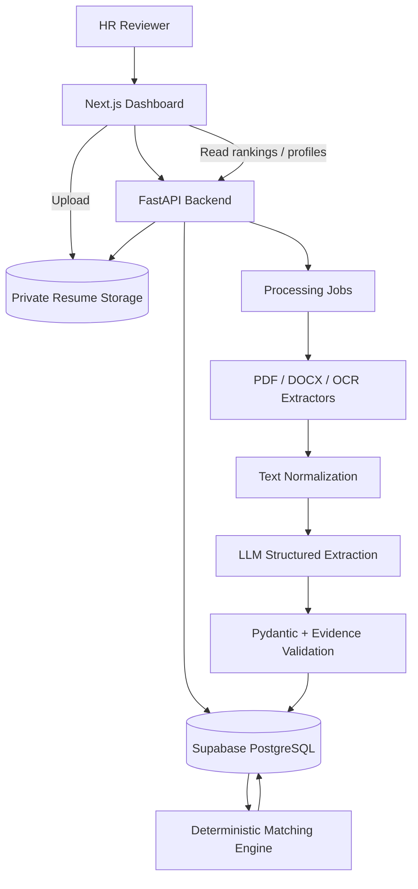

# GFI AI Resume Screener — Architecture

**Status:** Initial technical design  
**Primary development environment:** Antigravity  
**Frontend deployment:** Vercel  
**Backend:** Python FastAPI service, deployed separately

## 1. Architecture principles

1. Separate extraction, normalization, scoring, and presentation.
2. Use an LLM for structured extraction and concise evidence summaries, not as the final scoring authority.
3. Keep scoring deterministic, versioned, and testable.
4. Preserve source files and traceable evidence.
5. Treat resumes as untrusted input.
6. Process batches asynchronously so one problematic file cannot stop the entire batch.
7. Keep secrets on the server; never expose model API keys to the browser.

## 2. Recommended stack

### Frontend
- Next.js App Router
- TypeScript
- Tailwind CSS
- shadcn/ui for accessible UI primitives
- Recharts for simple dashboard analytics
- React Hook Form + Zod for form validation where useful

### Backend
- Python 3.12+
- FastAPI
- Pydantic v2 for request/response and extraction schemas
- PyMuPDF for digital PDF text extraction
- python-docx for DOCX extraction
- OCR adapter (Tesseract or a hosted OCR service) only when needed
- LLM provider adapter for structured extraction
- Sentence Transformers or provider embeddings for semantic similarity only as a supporting signal

### Data and storage
- Supabase PostgreSQL for candidates, JDs, extracted profiles, evaluations, and processing records.
- Supabase Storage (private bucket) for original resumes.
- Use signed URLs or authenticated server-mediated downloads for source resumes.

### Deployment
- Next.js on Vercel.
- FastAPI API and worker on a suitable Python host.
- Supabase managed database and private object storage.
- Use environment variables for credentials and service URLs.

**Important:** Do not assume a free hosting tier can reliably run long OCR/LLM batch jobs. Verify current provider limits and use a background worker or resumable processing strategy.

## 3. High-level system diagram



## 4. Core data flow

### A. Initial batch ingestion
1. Admin uploads or imports the 47 source resumes.
2. Backend validates file type, size, and file hash.
3. File is stored in a private storage bucket.
4. A candidate record and processing job are created.
5. Worker extracts text from PDF/DOCX.
6. If the PDF appears scanned or has insufficient text, OCR is attempted if configured.
7. Normalization removes extraction noise without altering meaning.
8. LLM extracts a strict structured profile with evidence snippets.
9. Pydantic validates the response.
10. Evidence validation checks that cited snippets occur in extracted source text (allowing carefully normalized matching).
11. The profile is stored with extraction status, warnings, and model/schema versions.
12. The scoring engine evaluates the profile against both JDs.
13. Rankings are recalculated and the dashboard is updated.

### B. New resume upload
1. HR uploads a PDF/DOCX.
2. Backend validates and stores the file.
3. A processing job is queued.
4. The same extraction and validation pipeline runs.
5. Candidate is evaluated against both roles using the current published scoring configuration.
6. Both rankings update.
7. UI shows processing result, scores, evidence, and warnings.

### C. Reviewer inspection
1. HR opens a candidate.
2. UI requests profile, both evaluations, and processing metadata.
3. HR sees extracted data, source evidence, gaps, warnings, and score breakdown.
4. HR opens the original file using a short-lived signed URL or secure backend route.

## 5. Scoring architecture

Use a role-specific configuration:

```python
RoleConfig(
    role_id="LCA",
    criteria=[
        Criterion(id="...", label="...", weight=...),
    ],
    thresholds={
        "strong_match": ...,
        "possible_match": ...,
    },
)
```

The actual criteria and weights must be based on the supplied JD, not hardcoded assumptions.

For each candidate and role:
- Score each criterion on a normalized 0–100 scale.
- Record evidence IDs and missing-data status.
- Apply a documented missing-evidence policy.
- Calculate weighted score deterministically.
- Calculate extraction confidence separately.
- Store scoring version and timestamp.

Do not silently renormalize away missing mandatory evidence. Decide and document whether unknown criteria lower confidence, remain unscored, or trigger manual review. The policy should be consistent across candidates.

Semantic similarity may help retrieve relevant resume passages, but it must not independently determine eligibility or years of experience.

## 6. Proposed database model

### `job_descriptions`
- `id`
- `role_key` (`LCA`, `UI_UX`)
- `title`
- `source_text`
- `normalized_requirements` (JSONB)
- `requirements_version`
- `created_at`
- `updated_at`

### `candidates`
- `id` (UUID)
- `candidate_code` (e.g. `CAND-001`)
- `original_filename`
- `file_hash`
- `storage_path`
- `processing_status`
- `classification`
- `created_at`
- `updated_at`

### `resume_documents`
- `id`
- `candidate_id`
- `storage_path`
- `mime_type`
- `file_size`
- `extracted_text` or protected text reference
- `page_count`
- `parser_name`
- `parser_version`
- `warnings`
- `created_at`

### `candidate_profiles`
- `id`
- `candidate_id`
- `profile_json` (JSONB)
- `schema_version`
- `model_provider`
- `model_name`
- `prompt_version`
- `extraction_confidence`
- `validation_status`
- `created_at`

### `evidence_items`
- `id`
- `candidate_id`
- `field_key`
- `evidence_text`
- `page_number`
- `source_section`
- `validation_status`

### `scoring_configurations`
- `id`
- `role_key`
- `version`
- `criteria_json`
- `thresholds_json`
- `is_active`
- `approved_at`

### `candidate_evaluations`
- `id`
- `candidate_id`
- `role_key`
- `score`
- `classification`
- `criterion_results` (JSONB)
- `positive_evidence` (JSONB)
- `gaps` (JSONB)
- `confidence`
- `scoring_version`
- `created_at`

### `processing_jobs`
- `id`
- `candidate_id`
- `status`
- `stage`
- `attempt_count`
- `error_code`
- `error_message_safe`
- `started_at`
- `completed_at`

## 7. API design

Suggested endpoints:

| Method | Endpoint | Purpose |
|---|---|---|
| GET | `/api/health` | Service health |
| GET | `/api/jobs` | List job profiles |
| GET | `/api/jobs/{role_key}` | JD and current criteria |
| POST | `/api/resumes` | Upload a new resume |
| POST | `/api/resumes/batch` | Initial batch ingestion |
| GET | `/api/candidates` | Search/filter candidates |
| GET | `/api/candidates/{id}` | Candidate detail |
| GET | `/api/candidates/{id}/evaluations` | Both role evaluations |
| GET | `/api/rankings/{role_key}` | Ranked candidates |
| GET | `/api/jobs/{job_id}/status` | Processing status |
| POST | `/api/candidates/{id}/retry` | Retry failed processing |
| GET | `/api/methodology` | Published scoring methodology |

Use typed Pydantic request/response models. Add pagination to candidate and ranking endpoints.

## 8. Suggested repository structure

```text
gfi-ai-resume-screener/
├── frontend/
│   ├── app/
│   │   ├── (dashboard)/
│   │   │   ├── overview/
│   │   │   ├── roles/
│   │   │   │   ├── lca/
│   │   │   │   └── ui-ux/
│   │   │   ├── candidates/[id]/
│   │   │   └── methodology/
│   │   ├── upload/
│   │   ├── layout.tsx
│   │   └── globals.css
│   ├── components/
│   │   ├── layout/
│   │   ├── dashboard/
│   │   ├── candidates/
│   │   ├── rankings/
│   │   ├── upload/
│   │   └── shader/
│   ├── lib/
│   │   ├── api.ts
│   │   ├── schemas.ts
│   │   └── utils.ts
│   ├── public/
│   └── package.json
│
├── backend/
│   ├── app/
│   │   ├── main.py
│   │   ├── api/
│   │   ├── core/
│   │   ├── models/
│   │   ├── schemas/
│   │   ├── services/
│   │   │   ├── ingestion/
│   │   │   ├── extraction/
│   │   │   ├── normalization/
│   │   │   ├── evidence/
│   │   │   ├── matching/
│   │   │   └── storage/
│   │   ├── workers/
│   │   └── prompts/
│   ├── tests/
│   ├── requirements.txt
│   └── pyproject.toml
│
├── data/
│   ├── job_descriptions/
│   ├── sample_resumes/
│   └── processed_exports/
├── docs/
│   ├── PRD.md
│   ├── Architecture.md
│   ├── Rules.md
│   ├── Phases.md
│   └── Memory.md
├── .env.example
├── .gitignore
└── README.md
```

Do not commit actual candidate resumes, extracted personal data, secrets, or production `.env` files to Git.

## 9. WebGL shader integration

The user supplied a specific “Waves” WebGL1 fragment shader and its uniform packing instructions. Treat the supplied shader source as the source of truth; do not replace it with a CSS approximation or a different shader.

Implementation requirements:
- Create a dedicated `ShaderBackground` client component.
- Use a plain WebGL1 context; no rendering libraries.
- Render a fullscreen triangle.
- Pass the three supplied colors and packed uniforms exactly as specified in the shader header.
- Use the supplied values for the Waves preset; verify units and normalized values against the shader builder specification.
- Cap `devicePixelRatio` at 2.
- Resize the canvas with the viewport.
- Pause the animation frame loop when `document.visibilityState` is hidden; resume when visible.
- Handle WebGL context creation or shader compilation failure gracefully with a static dark/orange fallback.
- Clean up animation frames, event listeners, and WebGL resources on unmount.
- Respect `prefers-reduced-motion`; provide a static fallback.
- Canvas must be `position: fixed` or `absolute`, cover the intended region, and use `pointer-events: none`.
- Place content above it with a clear stacking context.
- Do not enable cursor interaction.
- Avoid using the shader behind dense candidate tables or long-form evidence. Use opaque surfaces there.

Suggested component:
`frontend/components/shader/ShaderBackground.tsx`

Keep the exact fragment shader in a separate source file or constant, and add a small test/manual verification checklist for uniform packing and lifecycle behavior.

## 10. Security and deployment

- Keep storage private.
- Validate MIME type and file signature, not only filename extension.
- Enforce upload size limits.
- Sanitize filenames and never use user filenames as filesystem paths.
- Do not expose storage service-role keys or LLM API keys in frontend code.
- Restrict CORS to deployed frontend origins.
- Add request timeouts and rate limits.
- Avoid logging full resume contents or sensitive personal details.
- Use short-lived signed URLs for document preview.
- Add database backups/export before final submission.
- Verify Vercel and backend hosting limits before choosing batch sizes.

## 11. Observability

Record:
- Candidate ID and processing stage.
- Parser/OCR outcome.
- Extraction schema validation outcome.
- Evidence validation outcome.
- LLM provider/model and prompt version.
- Scoring configuration version.
- Safe error code and retry count.
- Processing duration.

Do not store secrets or unnecessary resume text in application logs.
