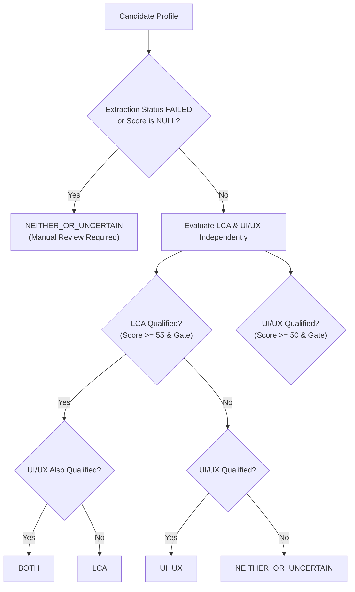

# Scoring Rules & Deterministic Evaluation Specification

**Version:** 1.0.0  
**Date:** 2026-11-10  
**Phase:** Phase 4 — JD Criteria & Deterministic Scoring Engine  
**Governing Documents:** [`docs/PRD.md`](file:///d:/Aryan/GFI-assignment/docs/PRD.md), [`docs/Architecture.md`](file:///d:/Aryan/GFI-assignment/docs/Architecture.md), [`docs/analysis/JD_Analysis.md`](file:///d:/Aryan/GFI-assignment/docs/analysis/JD_Analysis.md)

---

## 1. Principles of Deterministic Scoring

1. **Deterministic Execution:** The scoring algorithms are implemented purely in versioned Python code. Given the exact same candidate profile, the engine will compute the exact same score, breakdown, and classification 100% of the time with zero randomness.
2. **Orthogonal Role Scoring:** Every candidate receives two separate scores:
   - `score_lca` (0.0 to 100.0, or `null`)
   - `score_uiux` (0.0 to 100.0, or `null`)  
   The scores are never averaged, blended, or normalized against each other.
3. **Traceable Criterion Breakdown:** Each score is composed of named criteria. For every criterion, the engine outputs:
   - `criterion_key`: Unique string identifier
   - `criterion_name`: Human-readable label
   - `weight`: Maximum possible points
   - `score`: Awarded points
   - `evidence_snippets`: List of verified text quotes justifying the score
   - `rationale`: Explanation for HR reviewer
4. **Null vs. Zero Integrity (Mandatory Methodological Rule):**
   - If a document is unreadable, empty, or failed extraction, the score is strictly represented as `null`. It must **never** be assigned an artificial `0.0`. Its status is marked `MANUAL_REVIEW_REQUIRED`.
   - If a document was successfully extracted and contains zero evidence for the role, the score is legitimately `0.0`.
5. **Relocation Policy (Mandatory Methodological Rule):**
   - Missing relocation willingness is strictly `UNKNOWN`. It is treated as neutral (2/5 points) and never inferred as `FALSE`.

---

## 2. LCA Consultant Scoring Model (100 Points Max)

**Target Role:** LCA Consultant — Onsite Chennai  
**Authoritative Source:** `data/JD1 (LCA).txt` (Baseline: 2–3 years independent LCA experience, GaBi/SimaPro, ISO 14040/14044).

| Criterion Key | Criterion Name | Max Pts | Scoring Tiers & Logic | Source Citation |
| :--- | :--- | :--- | :--- | :--- |
| `lca_experience` | **LCA Project Experience** | **25** | - `>= 48 months` (Senior bonus): **25 pts**<br>- `24–47 months` (2–3 yrs baseline): **20 pts**<br>- `12–23 months`: **12 pts**<br>- `1–11 months`: **6 pts**<br>- `0 months` / no LCA role: **0 pts** | JD1 Lines 29–30: *"2 to 3 years of experience running LCA projects independently"* |
| `lca_tools` | **GaBi / SimaPro Modeling Tools** | **25** | - Both GaBi AND SimaPro: **25 pts**<br>- GaBi OR SimaPro (verified): **20 pts**<br>- Other LCA tool (openLCA, Air.e, Umberto): **10 pts**<br>- No LCA tools: **0 pts** | JD1 Lines 31–32: *"Hands-on experience using either GaBi or SimaPro software"* |
| `lca_standards` | **ISO 14040/14044 & EPD Standards** | **20** | - ISO 14040 or ISO 14044 verified: **14 pts**<br>- EPD (Environmental Product Declaration): **+6 pts**<br>- No standards cited: **0 pts** | JD1 Lines 35–36, 51: *"Strictly follow ISO 14040 and ISO 14044 guidelines", "EPD"* |
| `lca_education` | **Environmental Domain Degree** | **15** | - Master's / Bachelor's in Environmental Eng / Science / Sustainability: **15 pts**<br>- Other Engineering / STEM degree: **10 pts**<br>- Non-STEM degree: **5 pts**<br>- No degree: **0 pts** | JD1 Line 44: *"Bachelor’s or Master’s (Environmental domain highly desired)"* |
| `lca_projects` | **Documented LCA Projects** | **10** | - `>= 3 documented LCA projects`: **10 pts**<br>- `1–2 documented LCA projects`: **6 pts**<br>- `0 projects`: **0 pts** | JD1 Lines 33–34: *"Completed at least 03 LCA projects"* |
| `lca_location` | **Chennai Location / Relocation** | **5** | - Chennai resident or explicit YES to relocate: **5 pts**<br>- `UNKNOWN` (Methodology rule neutral credit): **2 pts**<br>- Explicit NO: **0 pts** | JD1 Lines 7, 37–39: *"Chennai (onsite)... relocate"* |

### Qualification Threshold (LCA)
- **Minimum Total Score:** `score_lca >= 55.0`
- **Mandatory Hard Gate:** Must possess verified LCA experience or verified core LCA tooling (GaBi, SimaPro, openLCA, or ISO 14040/14044).

---

## 3. UI/UX Design Intern Scoring Model (100 Points Max)

**Target Role:** UI/UX Designer Intern — Remote  
**Authoritative Source:** `data/JD2.txt` (Target: 0–1 year experience, Figma prototyping, user research/psychology, human-centered design).

| Criterion Key | Criterion Name | Max Pts | Scoring Tiers & Logic | Source Citation |
| :--- | :--- | :--- | :--- | :--- |
| `uiux_tools` | **Figma & Prototyping Tools** | **25** | - Figma + Secondary tool (Framer, XD, Protopie, Miro, Canva): **25 pts**<br>- Figma verified: **20 pts**<br>- Prototyping tools without Figma: **10 pts**<br>- No UI design tools: **0 pts** | JD2 Lines 11, 23: *"Create high-fidelity prototypes... using Figma"* |
| `uiux_methodology` | **Design Methodology & Systems** | **25** | - Wireframing + Prototyping + UI/UX Design: **15 pts**<br>- Design Systems / High-Fidelity Specs: **+10 pts**<br>- Basic UI design only: **8 pts**<br>- None: **0 pts** | JD2 Line 22: *"Proficiency in UI/UX design principles and human-centered design"* |
| `uiux_user_psychology` | **User Research & Psychology** | **20** | - Explicit User Psychology / Behavioral Design: **10 pts**<br>- Usability Testing / User Research Interviews: **10 pts**<br>- General user focus without testing: **5 pts**<br>- None: **0 pts** | JD2 Lines 9, 24, 28: *"Strong understanding of user psychology and behavior"* |
| `uiux_portfolio` | **Design Portfolio & Artifacts** | **15** | - Verified portfolio URL (Behance, Dribbble, Figma, site): **15 pts**<br>- Documented design case studies without URL: **10 pts**<br>- Academic design coursework: **5 pts**<br>- None: **0 pts** | JD2 Lines 11, 25, 30: *"High-fidelity prototypes", "eye for detail", "aesthetic sense"* |
| `uiux_experience` | **Target Intern Experience (0–1 yr)** | **10** | - `0–12 months` (Ideal internship target): **10 pts**<br>- Fresh graduate / design transitioner: **10 pts**<br>- `13–24 months`: **8 pts**<br>- `> 24 months` (Overqualified taper): **6 pts**<br>- No design background: **0 pts** | JD2 Line 19: *"0-1 year of experience in UX/UI design. If you're a recent graduate..."* |
| `uiux_alignment` | **Sustainability & Web Alignment** | **5** | - Sustainability, CleanTech, or Job Board / Marketplace experience: **5 pts**<br>- General web / mobile applications: **3 pts**<br>- None: **0 pts** | JD2 Lines 3, 34, 41: *"building LinkedIn for sustainability", "job board"* |

### Qualification Threshold (UI/UX)
- **Minimum Total Score:** `score_uiux >= 50.0`
- **Mandatory Hard Gate:** Must demonstrate verified Figma experience or documented UI/UX design portfolio / case studies.

---

## 4. Candidate Classification Matrix

Candidates are categorized into mutually exclusive classifications based on their independent qualification outcomes:



---

## 5. Deterministic Tie-Breaking Protocol

When two candidates share an identical total score within a role ranking, ties are resolved deterministically using the following hierarchy:

1. **Extraction Confidence (`extraction_confidence`):** The candidate with higher evidence verification confidence ranks higher.
2. **Primary Criterion Score:**
   - For LCA: higher score on `lca_experience` (months of independent LCA experience).
   - For UI/UX: higher score on `uiux_tools` (Figma and prototyping proficiency).
3. **Total Verified Claims Count:** Candidate with more verified evidence snippets in the profile.
4. **Stable Candidate Code Order:** Candidate codes sorted in ascending lexicographical order (`CAND-001` before `CAND-002`).

---

## 6. Audit & Explainability Interface Contract

Every evaluation output contains:
```json
{
  "role_key": "LCA",
  "score": 85.0,
  "scoring_version": "1.0",
  "is_qualified": true,
  "qualification_status": "QUALIFIED",
  "summary": "Candidate CAND-001 qualifies strongly for LCA Consultant with 36 months independent experience, verified GaBi/SimaPro tools, and ISO 14040/14044 compliance.",
  "breakdown": {
    "lca_experience": {
      "name": "LCA Project Experience",
      "weight": 25.0,
      "score": 20.0,
      "evidence": ["LCA Specialist at EcoCorp (2021 - Present, 36 months)"],
      "notes": "36 months independent experience meets 2-3 year baseline."
    },
    "lca_tools": {
      "name": "GaBi / SimaPro Modeling Tools",
      "weight": 25.0,
      "score": 25.0,
      "evidence": ["skilled in GaBi and SimaPro"],
      "notes": "Verified hands-on expertise in both GaBi and SimaPro."
    },
    "lca_standards": {
      "name": "ISO 14040/14044 & EPD Standards",
      "weight": 20.0,
      "score": 20.0,
      "evidence": ["ISO 14040, ISO 14044", "EPDs"],
      "notes": "Explicit ISO 14040/14044 compliance and EPD declaration experience."
    },
    "lca_education": {
      "name": "Environmental Domain Degree",
      "weight": 15.0,
      "score": 15.0,
      "evidence": ["M.Tech in Environmental Engineering"],
      "notes": "Master's degree in target environmental domain."
    },
    "lca_projects": {
      "name": "Documented LCA Projects",
      "weight": 10.0,
      "score": 6.0,
      "evidence": ["Conducted cradle-to-grave LCAs"],
      "notes": "Documented project work cited."
    },
    "lca_location": {
      "name": "Chennai Location / Relocation",
      "weight": 5.0,
      "score": 2.0,
      "evidence": [],
      "notes": "Relocation willingness UNKNOWN; assigned non-punitive neutral credit."
    }
  }
}
```

